# Native Sedenion Signal Processing: Hardware Architecture, PCB Netlist & Bill of Materials (BoM)

**Project:** Native 16D Sedenion $\mathrm{PG}(3,2)$ Pre-ADC Analog Crossbar & Dual-Octonion TEM Vector-Sensor Testbed  
**Author:** Dionisio Chiuratto Agourakis (`jai`)  
**Target TRL:** TRL-4 / TRL-5 Benchtop & Over-the-Air Hardware Validation

---

## 1. System Architecture Overview

```mermaid
flowchart LR
    subgraph ANT["1. Native Dyadic 2x2 Dual-Polarized Array"]
        P1["Patch 00 (E_θ, E_φ)"]
        P2["Patch 01 (E_θ, E_φ)"]
        P3["Patch 10 (E_θ, E_φ)"]
        P4["Patch 11 (E_θ, E_φ)"]
    end

    subgraph FEED["2. Passive 90°/180° Dyadic Hybrid Feed"]
        H_A["Lower Octonion Im(O)_A\n(Channels e_1..e_7: E_θ)"]
        H_B["Upper Octonion Im(O)_B\n(Channels e_9..e_15: E_φ ∠90°)"]
    end

    subgraph XBAR["3. Pre-ADC Analog Sedenion Crossbar PCB"]
        MUX["16x16 XOR Permutation & ±1 Differential Polarity Matrix\n(Controlled by 7-bit Zero-Divisor Blade Select GPIO)"]
        SUM["Passive Differential Summing Bus\nZ_out = R(t) · W_J (Jammer = 0 BEFORE ADC)"]
    end

    subgraph SDR["4. 8-Ch Coherent SDR / RFSoC Digitizer"]
        ADC["12/14-Bit Phase-Coherent ADCs\n(Zero Saturation / Clipping)"]
        FPGA["SystemVerilog Core (sedenion_crpa_beamformer.sv)\n+ Single-Snapshot Associator κ_S(R) = ||[R, π_O(R), e_8]|| / ||R||²"]
    end

    ANT --> FEED --> XBAR --> SDR
```

---

## 2. Complete Bill of Materials (BoM) — JLCPCB / Mouser / DigiKey

### A. Subsystem 1: $2 \times 2$ Dual-Polarized Dyadic Patch Array PCB ($2.45\text{ GHz}$ ISM or $1575.42\text{ MHz}$ GPS L1)
- **Substrate:** 4-Layer Rogers RO4350B ($\varepsilon_r = 3.48$, $\tan\delta = 0.0037$, $h = 1.524\text{ mm}$) or controlled-impedance FR4 ($120\text{ mm} \times 120\text{ mm}$ for $2.45\text{ GHz}$; $180\text{ mm} \times 180\text{ mm}$ for $1575.42\text{ MHz}$).
- **Patch Dimensions:**
  - **$2.45\text{ GHz}$ ISM Band (Legal Open-Air Jamming/Spoofing Bench):** Square patch $L = W = 31.8\text{ mm}$, element spacing $d = \lambda_0 / 2 = 61.2\text{ mm}$, dual orthogonal coaxial/microstrip inset feeds per patchPort 1 ($\mathbf{E}_\theta$, $0^\circ$) and Port 2 ($\mathbf{E}_\phi$, $90^\circ$).
  - **$1575.42\text{ MHz}$ GPS L1 Band (Shielded Chamber / Cabled Bench):** Square patch $L = W = 49.4\text{ mm}$, element spacing $d = \lambda_0 / 2 = 95.1\text{ mm}$.

| RefDes | Qty | Part Number | Manufacturer | Description | Unit Cost (USD) | Ext. Cost |
| :--- | :---: | :--- | :--- | :--- | :---: | :---: |
| `U1–U4` | 4 | `QCN-25+` (or `QCN-19+` for L1) | Mini-Circuits |Passive $90^\circ$ Quadrature Hybrid Coupler (enforces $\langle a, b \rangle = 0, \|a\|=\|b\|$) | \$3.45 | \$13.80 |
| `T1–T8` | 8 | `TCM1-63AX+` | Mini-Circuits | $50\,\Omega$ to $50\,\Omega$ $180^\circ$ RF Flux-Coupled Balun Transformer ($10\text{--}6000\text{ MHz}$) | \$2.95 | \$23.60 |
| `U5–U12` | 8 | `PGA-103+` | Mini-Circuits | Ultra-Low-Noise figure ($0.5\text{ dB}$ NF), High-IP3 ($+39\text{ dBm}$ OIP3) Gain Matched LNA | \$2.80 | \$22.40 |
| `J1–J16` | 16 | `CONSMA006.062` | Linx / TE | Edge-launch $50\,\Omega$ gold SMA female connectors | \$1.40 | \$22.40 |
| `PCB1` | 1 | Custom 4-Layer PCB | JLCPCB | $2\times 2$ Dual-Polarized Dyadic Patch + Hybrid Feed PCB | \$35.00 | \$35.00 |

---

### B. Subsystem 2: Pre-ADC Analog Sedenion Zero-Divisor Crossbar PCB (Baseband / IF Stage)
Executes exact primitive zero-divisor blade multiplication $Z_{\mathrm{out}}(t) = R(t) \cdot \frac{1}{\sqrt{2}}(e_c \pm e_d)$ in **analog differential circuitry ahead of the ADC**, using zero multipliers:
- **How $\pm 1$ Multiplication Works in Analog Hardware:** Each of the 16 sedenion basis channels $x_0(t), \dots, x_{15}(t)$ is carried as a **differential voltage pair** $(V_i^+, V_i^-)$. Multiplying by $+1$ passes $(V_i^+, V_i^-)$ straight through; multiplying by $-1$ simply **swaps the differential wires** $(V_i^-, V_i^+)$ via a low-on-resistance analog DPDT crossbar switch (`ADG1634`)!
- **How `i = k ^ j` XOR Routing Works:** For any selected primitive zero-divisor partner $W_J = \frac{1}{\sqrt{2}}(e_c + s \cdot e_d)$ ($c \in \{1..7\}, d \in \{9..15\}, s \in \{+1, -1\}$), output channel $k \in \{0..15\}$ receives the analog sum of exactly **two** input channels:
  $$z_k(t) = \frac{1}{\sqrt{2}}\Bigl(\sigma(k \oplus c, c)\, x_{k \oplus c}(t) \;+\; s \cdot \sigma(k \oplus d, d)\, x_{k \oplus d}(t)\Bigr),$$
  where $\sigma(k \oplus j, j) = (-1)^{\text{\texttt{SIGN\_NEG\_KJ}}[k][j]} \in \{+1, -1\}$.

| RefDes | Qty | Part Number | Manufacturer | Description | Unit Cost (USD) | Ext. Cost |
| :--- | :---: | :--- | :--- | :--- | :---: | :---: |
| `SW1–SW16` | 16 | `ADG1611BCPZ` / `SN74CB3Q3253` | Analog Devices / TI | $1\,\Omega$ ultra-low-distortion quad SPST / dual 1:4 analog crossbar mux | \$3.10 | \$49.60 |
| `AMP1–AMP16` | 16 | `AD8130ARZ` | Analog Devices | $270\text{ MHz}$ Differential Receiver Amplifier (combines $\pm V_{k\oplus c}$ and $\pm V_{k\oplus d}$ with CMRR $> 80\text{ dB}$) | \$4.25 | \$68.00 |
| `R_SUM` | 64 | `ERA-3AEB1001V` | Panasonic | $1.00\,\text{k}\Omega$ $\pm 0.05\%$ thin-film precision summing resistors ($10\text{ ppm}/^\circ\text{C}$ — guarantees $>65\text{ dB}$ analog null depth) | \$0.35 | \$22.40 |
| `MCU1` | 1 | `RP2040` / `STM32G431` | Raspberry Pi / ST | Latches the 7-bit blade index ($0..83$) into the analog switch matrix in $<15\text{ ns}$ | \$1.50 | \$1.50 |
| `PCB2` | 1 | 4-Layer Mixed-Signal PCB | JLCPCB | Pre-ADC Analog Sedenion Crossbar & Differential Summing Board | \$25.00 | \$25.00 |

---

### C. Subsystem 3: 8-Channel Phase-Coherent SDR Digitizer (Choose One)

| Option | Hardware | Coherent Channels | Cost (USD) | Best For |
| :--- | :--- | :---: | :---: | :--- |
| **Option 1 (Budget Benchtop)** | **2$\times$ KrakenSDR** (locked via common noise source + 10 MHz sync) | $8\times$ Complex I/Q ($16\text{D Real} = \mathbb{S}$) | **\$1,190** | Immediate $1575.42\text{ MHz}$ L1 / $915\text{ MHz}$ ISM benchtop & over-the-air validation |
| **Option 2 (Wideband $2.45\text{ GHz}$)** | **4$\times$ Pluto+ (AD9361 Dual-Rx)** + **Leo Bodnar 40 MHz / 10 MHz Clock Dist.** | $8\times$ Complex I/Q up to $6\text{ GHz}$ | **\$1,350** | $2.45\text{ GHz}$ ISM band live over-the-air spoofing, jamming & ZDKM waveform demo |
| **Option 3 (DARPA RFSoC Target)** | **RealDigital RFSoC 4x2** or **AMD ZCU208** (Zynq UltraScale+ XCZU48DR) | Direct-RF GSPS ADCs + UltraScale+ FPGA | **\$4,800** | Drop-in synthesis of [`sedenion_crpa_beamformer.sv`](file:///Users/josaum/Documents/antigravity/wise-bell/bench/gps_jamming/rtl/sedenion_crpa_beamformer.sv) at $<10\text{ ns}$ latency |

**Total Entry-Level Complete Hardware Prototype Cost:** **~\$1,470 USD** (Antenna PCB + Analog Crossbar PCB + 8-Channel Coherent SDR).
