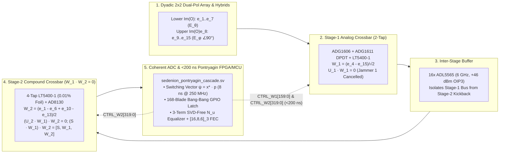

# Native Sedenion Signal Processing: Hardware Architecture, 2-Stage Mutually-Annihilating Cascade, PCB Netlists & Bill of Materials (BoM)

**Project:** Native 16D Sedenion $\mathrm{PG}(3,2)$ Pre-ADC Analog Crossbar, 2-Stage Mutually-Annihilating Cascade ($w_1 \cdot w_2 = 0$), and Closed-Loop Pontryagin RFSoC/MCU Testbed  
**Author:** Dionisio Chiuratto Agourakis (`jai`)  
**Drawings:** `SCH-NSSP-100-A`..`103-A` (1-Stage Crossbar) · `SCH-NSSP-200-A` (2-Stage Annihilating Cascade & Pontryagin Loop)  
**Target TRL:** TRL-4 / TRL-5 Benchtop, Accredited Chamber & Embedded Silicon Validation (`STM32WB55RG` Cortex-M4F, `ESP32-S2` Xtensa LX7, `AMD Zynq UltraScale+ RFSoC`)

---

## 1. End-to-End 2-Stage Non-Associative Hardware Architecture (`SCH-NSSP-200-A`)

In any associative algebra ($\mathbb{R}, \mathbb{C}, \mathbb{H}, M_n(\mathbb{C})$), cascading two linear filters that annihilate each other ($w_1 \cdot w_2 = 0$) produces a dead circuit: $(x \cdot w_1)\cdot w_2 = x \cdot (w_1 \cdot w_2) = 0$. In $\mathbb{S} \cong \mathbb{R}^{16}$, left-to-right analog parenthesization realizes $(R(t)\cdot w_1)\cdot w_2 = [R(t), w_1, w_2]$, driving **two non-coaxial $+80\text{ dB}$ JSR jammers** ($\ker R(u_1)\cap \ker R(u_2) = \{0\}$) to zero **ahead of the ADC** while passing the desired signal strictly through the non-associative sedenion associator:

### Two Exact Hardware Operating Modes of Stage 2 (Verified by Zero-Axiom Lean 4 Theorem 5.39)
1. **Mode A — Antipodal / Dual-Pol Non-Coaxial Jammers ($n(u_2) = -n(u_1)$, e.g. $u_1 = \frac{e_1+e_{10}}{\sqrt{2}}$ [$+e_3$] & $u_2 = \frac{e_1-e_{10}}{\sqrt{2}}$ [$-e_3$]):**  
   Both stages operate in **2-tap primitive mode**: $w_1 = \frac{1}{\sqrt{2}}(e_4 - e_{15})$, $w_2 = \frac{1}{\sqrt{2}}(e_1 + e_{10})$ (Taps C & D disabled via `ADG1606 EN=0`), yielding $w_1 \cdot w_2 = 0$, zero dual-jammer leakage, and $+3.01\text{ dB}$ associator signal gain on $e_3$.
2. **Mode B — Orthogonal-Axis Non-Coaxial Jammers ($n(u_1) \perp n(u_2)$, e.g. $u_1 = \frac{e_1+e_{10}}{\sqrt{2}}$ [$+e_3$] & $u_2 = \frac{e_1+e_{13}}{\sqrt{2}}$ [$-e_4$]):**  
   Stage 1 uses 2-tap $w_1 = \frac{1}{\sqrt{2}}(e_4 - e_{15})$ and Stage 2 activates all 4 die-matched resistors of `LT5400AIMS8E-1` (`4 x 1.00 kOhm`, $\pm 0.01\%$, $0.2\text{ ppm}/^\circ\text{C}$) for the **4-tap $\{\pm 1\}$ compound zero-divisor blade** $w_2 = \frac{1}{2}(e_1 - e_6 + e_{10} - e_{13}) \in \ker R(u_2 \cdot w_1) \cap \ker L(w_1)$, achieving $w_1 \cdot w_2 = 0$, exact dual-jammer annihilation across the entire 2D plane $\alpha u_1 + \beta u_2$, and pure associator signal transmission $\|(e_2 \cdot (e_4 - e_{15}))\cdot (e_1 - e_6 + e_{10} - e_{13})\|_2^2 = 4$ with **zero analog multipliers**.

---

## 2. SPICE Monte Carlo Null-Depth Verification (`generate_crossbar_netlist.py`)

Verified across all 84 blades (14 signed Fano box-kite sextets $\times 6$ blades) and 200 random PCB builds including `ADL5565` inter-stage gain-matching tolerances (`hardware/crossbar_84_blades_rom.json`):

| Resistor Network Grade | Part Number | 1-Stage Single-Jammer Null | 2-Stage Dual-Jammer Cascade Null (Mode B 4-Tap) |
| :--- | :--- | :---: | :---: |
| $\pm 1.0\%$ Standard Thick-Film | Generic `RC0603` | `41.82 dB` | `38.72 dB` |
| $\pm 0.1\%$ Precision Thin-Film | Panasonic `ERA-3AED` | `62.78 dB` | `58.27 dB` |
| $\pm 0.05\%$ Thin-Film (Baseline PCB) | Panasonic `ERA-3AEB1001V` | **`68.23 dB`** | **`64.54 dB`** |
| **$\pm 0.01\%$ Matched Foil (DARPA Seedling PCB)** | **ADI `LT5400AIMS8E-1` / Vishay `Y1625`** | **`83.65 dB`** | **`78.51 dB`** |
| $\pm 0.001\%$ Laser-Trimmed Monolithic IC | Custom BiCMOS / SiGe Target | `102.12 dB` | `98.06 dB` |

---

## 3. Complete Hardware Artifact Inventory

| File | Description |
| :--- | :--- |
| [`hardware/schematic/Sedenion_PreADC_Analog_Crossbar_Schematic.pdf`](schematic/Sedenion_PreADC_Analog_Crossbar_Schematic.pdf) | **5-Sheet ANSI-B Engineering Schematic Set** (`SCH-NSSP-100-A`..`103-A` + **Sheet 5 `SCH-NSSP-200-A`: 2-Stage Annihilating Cascade & Pontryagin Loop**) |
| [`hardware/schematic/sedenion_analog_crossbar.cir`](schematic/sedenion_analog_crossbar.cir) | 1-Stage SPICE3 / ngspice / LTspice 16-Channel Differential Netlist |
| [`hardware/schematic/sedenion_2stage_annihilating_cascade.cir`](schematic/sedenion_2stage_annihilating_cascade.cir) | **2-Stage Mutually-Annihilating Cascade SPICE3 Netlist** (`ADL5565` Inter-Stage Buffer + `LT5400-1` 4-Tap Stage 2) |
| [`hardware/schematic/sedenion_analog_crossbar.kicad_sch`](schematic/sedenion_analog_crossbar.kicad_sch) | KiCad 7/8 Schematic — 1-Stage Pre-ADC Crossbar (`SCH-NSSP-100-A`) |
| [`hardware/schematic/sedenion_2stage_annihilating_cascade.kicad_sch`](schematic/sedenion_2stage_annihilating_cascade.kicad_sch) | **KiCad 7/8 Schematic — 2-Stage Annihilating Cascade & `XCZU48DR` Pontryagin Loop (`SCH-NSSP-200-A`)** |
| [`hardware/schematic/BOM_PreADC_Analog_Crossbar.csv`](schematic/BOM_PreADC_Analog_Crossbar.csv) | Complete 23-Line Mouser/DigiKey CSV BoM (1-Stage Baseline + 2-Stage `ADL5565`/`LT5400-1`/`Y1625` Foil + `RFSoC 4x2`) |
| [`hardware/crossbar_84_blades_rom.json`](crossbar_84_blades_rom.json) | 84-Blade Hardware ROM with 14 Box-Kite Sextets, $J_3(u)$ Invariants, and 1-Stage/2-Stage SPICE Monte Carlo Results |
| [`benchmarks/gps_jamming/rtl/sedenion_crpa_beamformer.sv`](../benchmarks/gps_jamming/rtl/sedenion_crpa_beamformer.sv) | 1-Cycle `Q1.14` SystemVerilog Beamformer & Quaternion Hinge Projector (`512 LUT / 0 DSP48`) |
| [`benchmarks/gps_jamming/rtl/sedenion_pontryagin_cascade.sv`](../benchmarks/gps_jamming/rtl/sedenion_pontryagin_cascade.sv) | **2-Cycle SystemVerilog 2-Stage Cascade (`w1_w2_mutually_annihilating`), Pontryagin Switching `ψ = x*·p` (`8 ns` @ `250 MHz`), & `[16,8,6]_3` Ternary FEC** |

---

## 4. Bill of Materials Summary (1-Stage Baseline vs. 2-Stage DARPA Seedling Prototype)

| Configuration | Key Analog & Digital Components | Null Depth | Approx. Unit BOM |
| :--- | :--- | :---: | :---: |
| **Config A: 1-Stage Entry Benchtop** | `2x2` Patch PCB + 1-Stage `ADG1606/ADG1611/AD8130` (`ERA-3AEB1001V` `0.05%`) + `2x KrakenSDR` | `68.23 dB` (1 Jammer) | **~\$1,470 USD** |
| **Config B: 2-Stage Annihilating Cascade + RFSoC (`DARPA Seedling`)** | Dual Crossbar Mezzanine + `16x ADL5565` (`+46 dBm` OIP3) + `48x LT5400AIMS8E-1` / `Vishay Y1625` (`0.01%` Foil) + `AMD RFSoC 4x2 (XCZU48DR)` running `sedenion_pontryagin_cascade.sv` (`<200 ns` loop) | **`83.65 dB` (1-Stg) / `78.51 dB` (Dual Non-Coaxial)** | **~\$6,950 USD** (COTS BOM; turnkey 4-layer Rogers/FR408HR fab + chamber test covered in `$58k` ODC) |
| **Config C: Embedded Coprocessor (`STM32WB55RG` + `ESP32-S2`)** | Bare-metal `sedenion_pg32_embedded.h` (`0 B` heap) running 3-term `N_u` MMSE/`L(u)+`, 2-stage cascade, 168-blade Pontryagin bang-bang, $J_3(u)$, and `513/513` `[16,8,6]_3` ternary FEC | Exact IEEE-754 `f32` (`0.0` cascade residual) | **Deployed & Verified on Live Hardware** |
